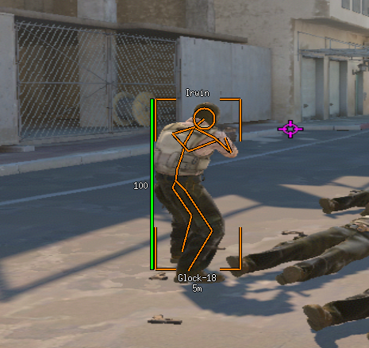
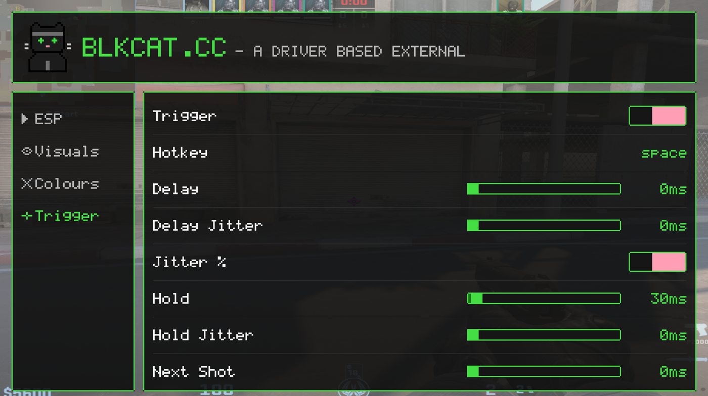

# blkcat

A Counter-Strike 2 external for Linux. A small kernel module reads the game's
memory and injects mouse input; a userspace overlay draws the ESP and a settings
menu over the top of the game.





## How it works

- `kernel/` is a misc device at `/dev/blkcat`. It reads another process's memory
  through `mm` page tables (`BLKCAT_IOCTL_READ_MEM`) and registers a virtual
  input device so userspace can press mouse buttons (`BLKCAT_IOCTL_MOUSE_BTN`,
  `BLKCAT_IOCTL_MOUSE_CLICK`). No process is attached to or suspended.
- `external/` finds `cs2` in `/proc`, resolves `libclient.so`/`libengine2.so`
  from `/proc/<pid>/maps`, and reads the world through the driver.
- The overlay is an `override_redirect` window on the game's X display, shaped
  so it takes no input while the menu is closed and tagged as a gamescope
  external overlay. It renders into a pixmap and copies it across once a frame.

Offsets are not stored in the tree. They are fetched at startup from
[blkcatcc/cs2-dumper](https://github.com/blkcatcc/cs2-dumper), so a game update
does not need a code change. Startup therefore needs network access.

## Requirements

- Linux with headers for the running kernel (`linux-headers`/`linux-headers-$(uname -r)`)
- X11, or gamescope (an X display on `:1` by default, see `BLKCAT_DISPLAY`)
- `libX11`, `libXext`, `libXrender`, `libcurl`, `pkg-config`, a C compiler

## Build

```sh
make -C kernel                  # kernel module
cd external && make             # overlay + features
```

## Run

```sh
./kernel.sh load                # builds the module if needed, then insmod
cd external && sudo ./blkcat
```

`blkcat` needs root to open `/dev/blkcat`, then drops to the uid that owns the
X socket before drawing anything. It also opens `/dev/input` to track the menu
cursor while the mouse is grabbed; if it cannot, the menu still works but the
wheel and drag are unavailable.

`kernel.sh` also takes `unload`, `reload` and `status`.

## Features

**ESP** — corner box or full box, adjustable thickness, outline, skeleton, name,
health bar, health text, weapon, distance, head circle. Each element has its own
colour, set with an HSV picker or by typing a hex value.

**Triggerbot** — fires when the game's own crosshair trace is on an enemy, so it
respects walls and smoke. Hold the hotkey and it will shoot.

| Setting | Meaning |
| --- | --- |
| Hotkey | X11 keysym, default 32 (space). Set it by pressing the key on the Trigger page |
| Delay | wait after the crosshair lands before the first shot |
| Delay Jitter | +/- the delay, as a percentage or a raw millisecond count |
| Jitter % | whether jitter is a percentage or milliseconds |
| Hold | how long the button stays down |
| Hold Jitter | +/- the hold time, same two modes |
| Next Shot | cooldown after release before the next shot |

Timing is quantised to the frame (~16.7 ms), so a 50 ms delay lands at 50-67 ms.

## Menu

`F11` opens and closes it, `Esc` closes it. Click a toggle, drag a slider, click
a hex field and type a value, click the Hotkey row and press the key you want.
The wheel walks the page list when the cursor is over the nav and scrolls the
row list when it is over the content. Everything is saved to `blkcat.cfg` as you
change it and reloaded on the next frame, so the file can be edited by hand.

## Config

`external/blkcat.cfg`. Booleans accept `true/false`, `1/0`, `on/off`, `yes/no`;
colours are `RRGGBB` hex. A missing file or key keeps the built-in default.

| Variable | Default | Meaning |
| --- | --- | --- |
| `BLKCAT_DISPLAY` | `:1` | X display to draw on |
| `BLKCAT_CONFIG` | `blkcat.cfg` | config path |
| `BLKCAT_DUMP_BONES` | - | dump bone offsets to `/tmp/blkcat_bones.txt` |
| `BLKCAT_DUMP_TRIGGER` | - | print triggerbot state to stderr |

The two dump switches also trigger on `/tmp/blkcat_dump` and
`/tmp/blkcat_trigger` existing, which is easier when the process is started from
a shell that has already dropped to the display user.

## License

MIT, apart from `kernel/`, which is GPL-2.0.

The module has to be GPL-2.0: it calls `access_process_vm`, which the kernel
exports `EXPORT_SYMBOL_GPL`, and GPL-only symbols are invisible to modules that
do not carry a GPL-compatible license. The per-file
`SPDX-License-Identifier` headers under `kernel/` are authoritative for those
files; the MIT `LICENSE` in the root covers everything else.
